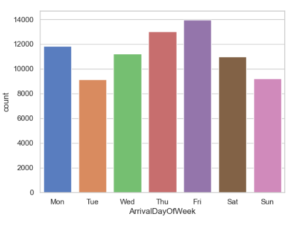
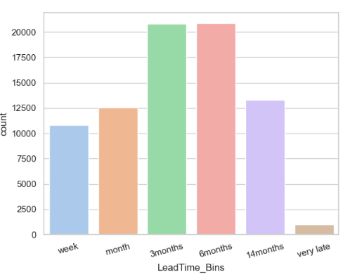
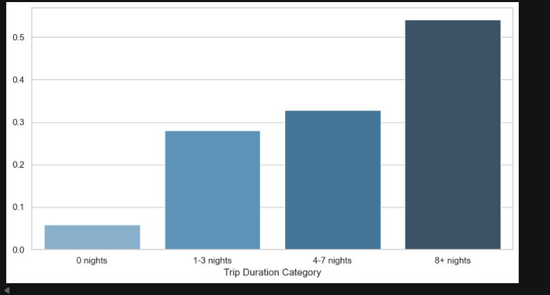
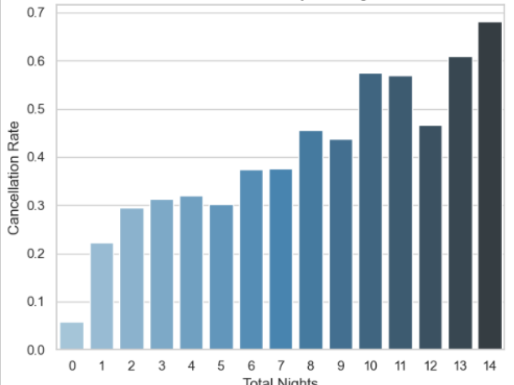
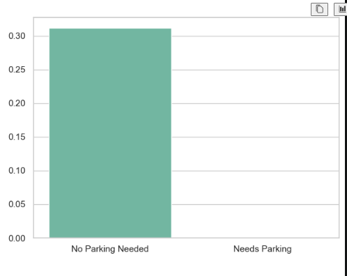

new column specifying the exact day of the week(drop arrrivaldateweeknumber arrivaldatedayofmonth)
numerical on Leadtime is very bad better to group them (1 to 7 days isnt the same as 300 to 307 days)
specifying the rate of canelation against total nights

and for some reasons everyone who requested parking didnt cancel?? 
